# Ad Click-Through-Rate Analysis and Creative Segmentation

An end-to-end analysis of mobile ad performance on the [Avazu CTR Prediction](https://www.kaggle.com/c/avazu-ctr-prediction)
dataset: raw impression logs are aggregated into creative-level records, explored, tested for statistical differences,
modeled with six regression and classification models, and segmented with K-Means.

Built as the final project for INET 4061 at the University of Minnesota.

The full notebook with all outputs is [`ctr_analysis.ipynb`](ctr_analysis.ipynb).

> **Read before using the model scores.** One engineered feature leaks the target, so the model scores in this
> notebook are inflated. The exploratory analysis, the hypothesis test, and the clustering are unaffected.
> See [Target leakage](#target-leakage-in-the-model-results).

## Business question

Advertisers pay for clicks, and platforms rank creatives by expected click-through rate (CTR = clicks / impressions).
If CTR can be estimated before a creative gets wide exposure, budget can shift toward strong creatives sooner and away
from weak ones. This project asks:

1. How is CTR distributed across creatives, and what is it related to?
2. Do creatives with more exposure have a different CTR from creatives with less?
3. Can placement and context features predict CTR?
4. Do creatives fall into distinct performance segments?

## Data and pipeline

| Step | Result |
|---|---|
| Raw rows read from `train.gz` | 500,000 impressions (24 columns: click, hour, banner position, site/app, device, anonymized C1–C21) |
| Aggregate to creative level | creative = site or app + banner position + C1; impressions (`pv`) and clicks (`clk`) summed per creative per day |
| Filter `pv >= 10` | 3,369 records → **1,191 creatives** across 1,180 sites/apps, 493,823 impressions |
| Data quality checks | 0 missing values, 0 rows with clicks > impressions, 0 duplicates, 0 negative values |
| Feature engineering | `log_pv`, banner position, app vs site, device type, connection type, day of week, weekend flag, creatives per site/app, site/app CTR rank |
| Targets | regression: CTR; classification: CTR above the median (8.33%), giving 587 high vs 604 low |

## Exploratory findings

**CTR is heavily right-skewed.** The median creative gets 8.3% CTR while the mean is 12.6%. A quarter of creatives sit
at or below 1.1%, and the top 5% exceed 41%. Impressions are skewed even more: median 37, mean 415, max 137,689.

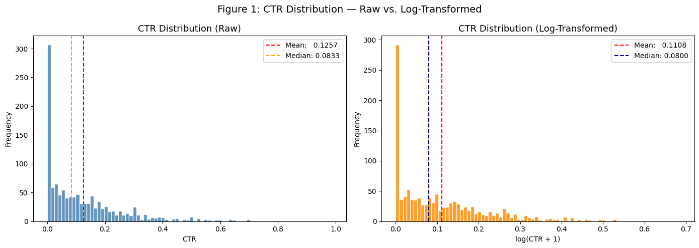

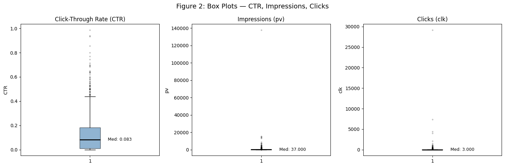

**Exposure and CTR are almost unrelated by rank.** Spearman's rho between impressions and CTR is 0.019 (p = 0.51).
Clicks correlate with CTR (rho = 0.73) only because clicks are the numerator.

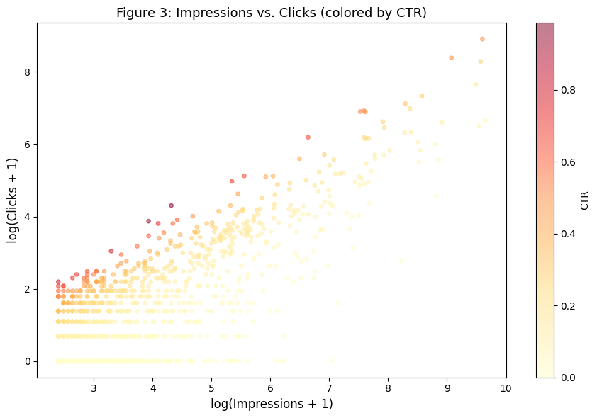

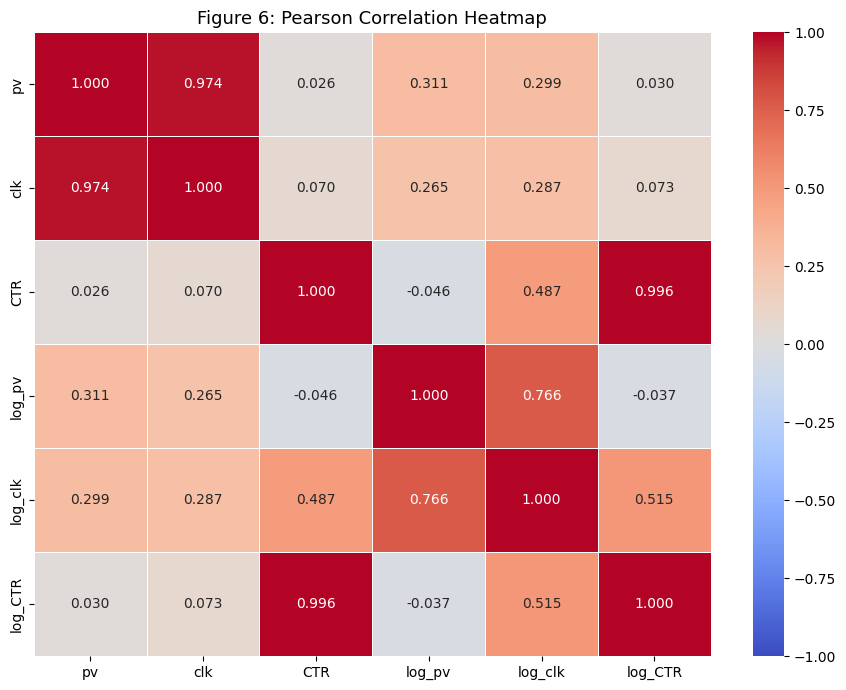

**Banner position barely moves median CTR.** Position 0 (987 creatives) has a median of 8.2% and position 1
(199 creatives) 8.6%. The other positions have one or two creatives each, too few to read.

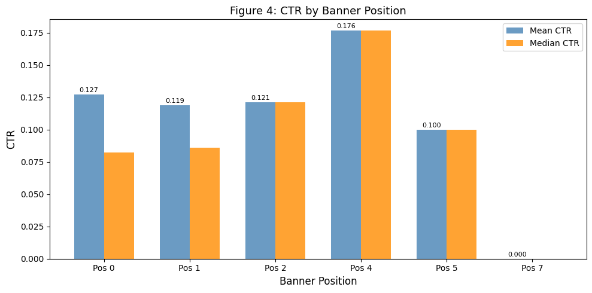

## Hypothesis test: does high exposure mean a different CTR?

- **H0:** high-impression and low-impression creatives have the same CTR distribution.
- **Split:** above vs at-or-below the 75th percentile of impressions (139).
- **Test:** Mann-Whitney U, chosen because CTR is skewed and far from normal.

| Group | n | Median CTR |
|---|---|---|
| High exposure (pv > 139) | 298 | 9.51% |
| Low exposure (pv ≤ 139) | 893 | 7.58% |

U = 144,322, **p = 0.027**, so H0 is rejected at the 5% level. Highly exposed creatives have a modestly higher CTR.
The effect is small, and since the Spearman correlation over all creatives is near zero, the difference sits in the
upper tail and is not a steady trend. One plausible reading is that platforms already serve better creatives more
often, which would make exposure a result of CTR, not a cause of it. This data cannot separate the two.

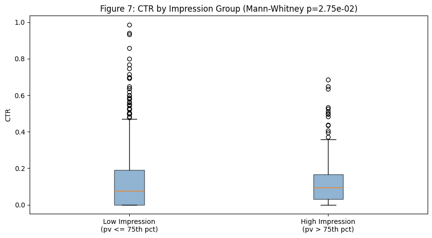

## Models

Data split 80/20 (952 train, 239 test). Each model family was fit for both targets, and XGBoost was tuned with
`RandomizedSearchCV` (3-fold) and then checked with 5-fold cross-validation.

| Regression (CTR) | MAE | RMSE | R² |
|---|---|---|---|
| Linear Regression | 0.0456 | 0.0724 | 0.756 |
| Random Forest | 0.0019 | 0.0106 | 0.995 |
| XGBoost | 0.0052 | 0.0149 | 0.990 |
| XGBoost (tuned) | 0.0041 | 0.0097 | 0.996 |

| Classification (high vs low CTR) | Accuracy | F1 | ROC-AUC |
|---|---|---|---|
| Logistic Regression | 0.979 | 0.980 | 0.999 |
| Random Forest | 1.000 | 1.000 | 1.000 |
| XGBoost | 0.992 | 0.992 | 1.000 |
| XGBoost (tuned) | 0.996 | 0.996 | 0.999 |

5-fold CV for tuned XGBoost: regression RMSE 0.0274 ± 0.0108, R² 0.961 ± 0.029; classification ROC-AUC 0.9985,
F1 0.992.

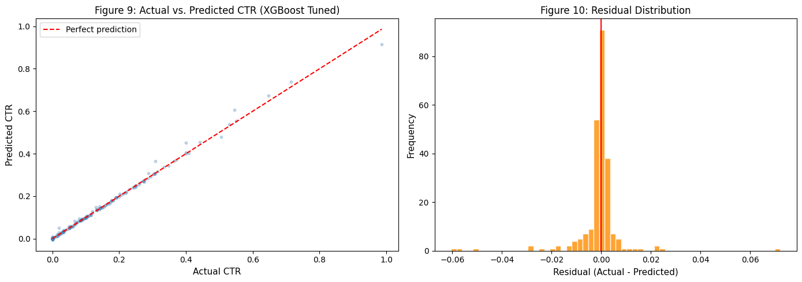

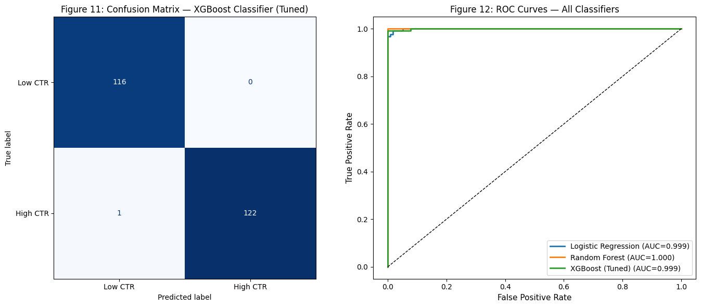

### Target leakage in the model results

These scores are too good for CTR prediction, and the feature importances show why:

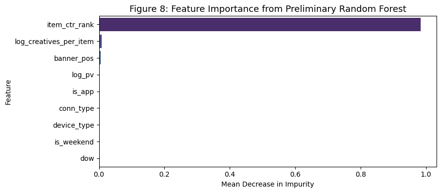

`item_ctr_rank` carries **98.3%** of the importance. It is the percentile rank of each site/app's median CTR,
computed over the whole dataset before the train/test split. Each site/app has 1.01 creatives on average, so that
median is almost always the creative's own CTR, and the feature gives the target to the model. Every other feature
together accounts for under 2%.

What this means:

- The regression, classification, and cross-validation scores above measure leakage, not predictive skill.
- `dow` and `is_weekend` have zero importance because the 500,000 rows all fall on one day (2014-10-21).
- The exploratory analysis, the Mann-Whitney test, and the clustering below do not use `item_ctr_rank` as a model
  input and still hold.

The fix is to drop `item_ctr_rank`, or to compute it out-of-fold from training rows only, and to load several days of
data so time features vary. That rerun is the next step for this repo.

## Creative segmentation (K-Means)

K-Means on standardized `log_pv`, CTR, creatives per site/app, and day of week. The elbow plot supports k = 4, and a
2-component PCA projection (71.3% of variance) is used to visualize the clusters.

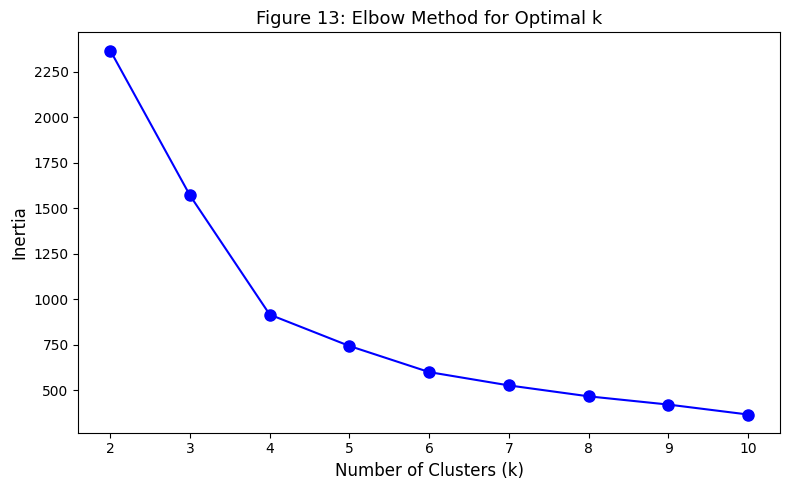

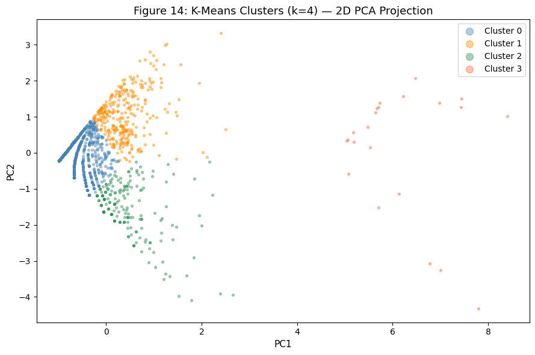

| Cluster | Median impressions | Median CTR | Reading |
|---|---|---|---|
| 0 | 24 | 3.7% | low reach, low CTR: candidates to pause or rework |
| 1 | 291 | 9.4% | high reach, about-average CTR: the steady core |
| 2 | 20.5 | 33.1% | low reach, high CTR: under-exposed winners, candidates for more budget |
| 3 | 68 | 8.7% | sites/apps running two creatives (a small group of outliers on PC1) |

Cluster 2 is the most actionable group: these creatives earn high CTR on little traffic. Small samples inflate CTR
too, though, so the right move is to give them more impressions as a test before treating them as proven.

## Conclusions

1. CTR is concentrated: a small share of creatives earn most clicks, so ranking creatives matters more than tuning the
   average.
2. Highly exposed creatives have a modestly higher CTR (p = 0.027), but rank correlation with exposure is near zero.
3. Placement and device features alone explain little; the model results are driven by a leaked feature and should
   not be used as a performance estimate.
4. Segmentation finds a clear group of low-traffic, high-CTR creatives worth testing with more budget.

## Limitations

- One day of data (500,000 of Avazu's 40M+ rows), so no weekly or seasonal effects.
- About one creative per site/app, so "creative" and "site/app" are nearly the same unit.
- CTR on creatives with 10–50 impressions is noisy; a Bayesian or Wilson-interval adjustment would make rankings
  more stable.
- Exposure is not randomly assigned, so the hypothesis test shows association, not cause.

## Running it

```bash
pip install -r requirements.txt
# Accept the competition rules on Kaggle, then:
kaggle competitions download -c avazu-ctr-prediction -f train.gz
gunzip -c train.gz > train.csv
jupyter notebook ctr_analysis.ipynb   # update the CSV path in the data-loading cell
```

The notebook was written for Google Colab and reads `/content/train.csv`.
